  

## 🙋 About me

I'm a developer who likes problems that fight back. If something doesn't work the way it should,
I want to know why, and I usually don't stop until it does.

- 🔭 Currently building **[SubSync Echo](https://github.com/resonaut/SubSync-Echo)**, an app that listens to a film and puts every subtitle line exactly where it's spoken
- 🧠 Into speech recognition, audio, and making AI run offline on ordinary computers
- 🎵 Soft spot for music and media apps
- 🏷️ My sound and audio projects live under **[Resonaut](https://github.com/resonaut)**
<!-- Add your own lines, for example:
- 🎓 Studying ...
- 📍 Based in ...
- ⚡ Fun fact: ...
-->

## 🚀 Things I've built

<table>
  <tr>
    <td width="50%" valign="top">
      
      <b><a href="https://github.com/resonaut/SubSync-Echo">SubSync Echo</a></b> 
      C++ · Python · Whisper
        
      Syncs subtitles to the speech in a video, in almost any language, fully offline.
    </td>
    <td width="50%" valign="top">
      <b><a href="https://github.com/Z0rdic/Connect-Four">Connect Four</a></b> 
      C++
        
      The classic four-in-a-row game, written in C++.
    </td>
  </tr>
</table>

## 🛠️ Tech Stack

**Languages**

**Mobile**

**Tools & platforms**

## 📊 Stats

  <picture>
    <source media="(prefers-color-scheme: dark)" srcset="https://github-readme-stats-rho-tan-16.vercel.app/api?username=Z0rdic&show_icons=true&include_all_commits=true&rank_icon=github&hide_border=true&bg_color=00000000&title_color=5EEAD4&icon_color=A78BFA&text_color=C7D2FE&ring_color=A78BFA">
    
  </picture>
  <picture>
    <source media="(prefers-color-scheme: dark)" srcset="https://streak-stats.demolab.com?user=Z0rdic&hide_border=true&background=00000000&stroke=3B4170&ring=A78BFA&fire=5EEAD4&currStreakNum=A78BFA&sideNums=7DD3FC&currStreakLabel=A78BFA&sideLabels=7DD3FC&dates=5EEAD4">
    
  </picture>
   
  <picture>
    <source media="(prefers-color-scheme: dark)" srcset="https://github-readme-stats-rho-tan-16.vercel.app/api/top-langs/?username=Z0rdic&layout=compact&langs_count=8&hide_border=true&bg_color=00000000&title_color=5EEAD4&text_color=C7D2FE">
    
  </picture>

## 📈 Contribution graph

<picture>
  <source media="(prefers-color-scheme: dark)" srcset="https://github-readme-activity-graph.vercel.app/graph?username=Z0rdic&hide_border=true&bg_color=00000000&color=C7D2FE&title_color=5EEAD4&line=5EEAD4&point=A78BFA&area=true&area_color=A78BFA">
  
</picture>

## 🐍 Contributions

  <picture>
    <source media="(prefers-color-scheme: dark)" srcset="https://raw.githubusercontent.com/Z0rdic/Z0rdic/output/snake-grid-dark.svg">
    
  </picture>

## 🤝 Connect

<!-- More links, uncomment and fill in:

-->

---

  Pixels matter. <b>Sound matters more.</b> 🔊

