  

  

## 👨‍💻 About

- 🔭 Currently working on **[SubSync Echo](https://github.com/resonaut/SubSync-Echo)**
- 🎧 All my sound projects live at **[github.com/resonaut](https://github.com/resonaut)**
- 🌱 Exploring speech recognition, audio processing and offline AI
- 💬 Found a bug or have an idea? [Open an issue](https://github.com/resonaut/SubSync-Echo/issues)
<!-- To add a contact line, uncomment and fill in:
- 📫 Reach me: you@example.com
-->

## 🎧 Featured project

<table>
  <tr>
    <td width="112" align="center">
      
    </td>
    <td>
      <h3><a href="https://github.com/resonaut/SubSync-Echo">SubSync Echo</a></h3>
      Subtitles out of sync? SubSync Echo listens to the film and moves every line to the moment it's spoken,
      in almost any language, even when the subtitles and audio differ. Whisper and local translation,
      fully offline, Windows and Linux.  
      
      
      
    </td>
  </tr>
</table>

## 🛠️ Tech Stack

**Languages & frameworks**

**Tools & platforms**

---

Pixels matter. <b>Sound matters more.</b> 🔊

