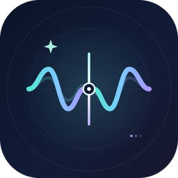

  

  

## 🙋 About me

I'm a developer who likes problems that fight back. If something doesn't work the way it should,
I want to know why, and I usually don't stop until it does.

- 🔭 Currently building **[SubSync Echo](https://github.com/resonaut/SubSync-Echo)**, an app that listens to a film and puts every subtitle line exactly where it's spoken
- 🧠 Into speech recognition, audio, and making AI run offline on ordinary computers
- 🎵 Soft spot for music and media apps
- 🏷️ My sound and audio projects live under **[Resonaut](https://github.com/resonaut)**
<!-- Add your own lines, for example:
- 🎓 Studying ...
- 📍 Based in ...
- ⚡ Fun fact: ...
-->

## 🚀 Things I've built

<table>
  <tr>
    <td width="50%" valign="top">
      
      <b><a href="https://github.com/resonaut/SubSync-Echo">SubSync Echo</a></b> 
      C++ · Python · Whisper
        
      Syncs subtitles to the speech in a video, in almost any language, fully offline.
    </td>
    <td width="50%" valign="top">
      <b><a href="https://github.com/Z0rdic/Connect-Four">Connect Four</a></b> 
      C++
        
      The classic four-in-a-row game, written in C++.
    </td>
  </tr>
</table>

## 🛠️ Tech Stack

**Languages**

**Mobile**

**Tools & platforms**

## 📊 GitHub activity

  
  

<!-- Contribution graph: uncomment once you have a few months of activity

  

-->

## 🤝 Connect

<!-- More links, uncomment and fill in:

-->

---

  Pixels matter. <b>Sound matters more.</b> 🔊 
  

